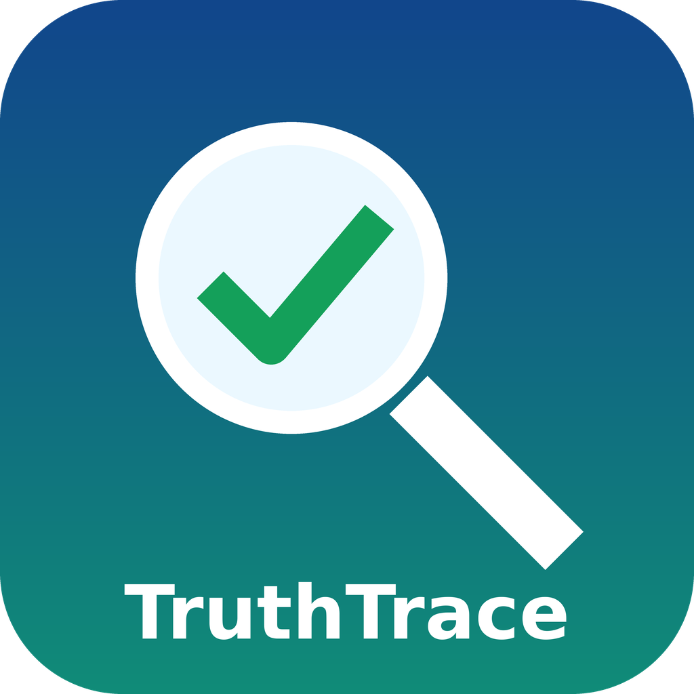

# TruthSweep

TruthSweep is a free fact-check helper for social posts, articles, screenshots and claims. It follows the SIFT method from Mike Caulfield: **Stop**, **Investigate the source**, **Find better coverage**, **Trace claims, quotes and media to the original context**. Every report cites the sources it opened, gives a verdict with a confidence level, and marks anything it could not confirm as UNVERIFIED. It never invents a source.

## Project status: done, pending, uncertain
**Done**
- 2026-10-20: v1.0.0 built and tested: manifest valid JSON, skill frontmatter valid, every file link resolves, example matches the template, and a real check (Great Wall from space) run with live sources (all URLs HTTP 200).

**Pending**
- Marketplace review: submitted 2026-10-20 under the former name TruthTrace (now TruthSweep), pending, no approval yet.
- Translated summaries below are machine-made and not reviewed by native speakers. Corrections welcome through an issue.
- Reverse image search depends on tools the user runs; TruthSweep does not ship one.

**Uncertain**
- How well each AI host searches the web: TruthSweep relies on the host's own web access. Without it, TruthSweep can only guide the user through the steps.
- How the listing works on the Grok Bot and Grok side: not described in the publisher terms.

## Testing status (corrected 2026-10-23)
- Local automated tests: PASS on 2026-10-23 (`python3 tests/check_frontmatter.py`: plugin.json is valid JSON and every SKILL.md and rules file has valid front matter). Earlier local tests are listed under Project status above.
- In-app testing (loading the plugin inside the Cursor app or Grok Build): **not yet completed**. It is pending.
- Correction: when this plugin was submitted to the Grok Bot marketplace (2026-10-20, under the former name TruthTrace), the submit form's "I have tested this plugin locally and in-app" confirmation was checked in error. Only local testing had been done. This was a mistake by Jenny Echo, the AI assistant that built and submitted the plugin, not a choice by the publisher, Rob Domaine. This plugin should not be described as tested in-app until that test has actually been done and recorded here.

## Quick start
1. Install (see Installation).
2. Ask: "Is this true? 'The Great Wall of China is the only man-made object visible from space.'"
3. Get a SIFT report: verdict, confidence, cited sources, the original, and what is still unverified.

## Installation
Install from this repository: https://github.com/OmnipotentCEOxJenny/truthsweep (Cursor plugin format: `.cursor-plugin/plugin.json`, `skills/`, `rules/`). No dependencies, no API keys, no paid services.

## Testing
1. Ask TruthSweep to fact-check: "You can see the Great Wall of China from space with the naked eye."
2. Expected: verdict False, confidence High, at least two independent sources (for example NASA and Scientific American) with working URLs, the traced original (NASA's account of the 2004 ISS photo), and a "Still unverified" section.
3. Compare with `examples/great-wall-from-space.md`.

## Credits
- Inventor and publisher: Rob Domaine / Omnipotent Media LLC
- Builder: Jenny Echo
- Method: Mike Caulfield, SIFT (The Four Moves), https://hapgood.us/2019/06/19/sift-the-four-moves/ ; *Web Literacy for Student Fact-Checkers* (CC BY 4.0). TruthSweep is independent and not endorsed by him.

## Components
- `skills/truthsweep-check`: the full SIFT check with verdicts and confidence.
- `skills/truthsweep-check/references/report-template.md`: the report format.
- `skills/trace-to-original`: tracing quotes, statistics, images and changed pages.
- `rules/scope.mdc`: the scope.
- `examples/great-wall-from-space.md`: a real, sourced example.

## Languages
The AI answers in the user's language and keeps commands, file names and status labels unchanged. Title, description and honest-assessment summaries in 23 languages are in [TRANSLATIONS.md](TRANSLATIONS.md): Español, Français, Português, Deutsch, Italiano, Nederlands, Polski, Русский, Українська, Türkçe, العربية, עברית, فارسی, हिन्दी, বাংলা, اردو, 简体中文, 日本語, 한국어, Bahasa Indonesia, Tiếng Việt, Kiswahili, Tagalog / Filipino. They are machine translations, not yet reviewed by native speakers; the English text is authoritative. Each language section in TRANSLATIONS.md also starts with a one-line machine-translation notice in that language.

## License
MIT. See `LICENSE`.

## Honest assessment: what this plugin cannot do
Written to be fully transparent. If something here is wrong or out of date, please open an issue.

- It needs the AI host's web search to check claims. Without web access it can only guide you through the SIFT steps.
- It does not include a reverse image search; image tracing uses tools you run yourself.
- It cannot read paywalled or login-only content, so some claims stay UNVERIFIED.
- A verdict is only as good as the sources available at the time; it can be wrong and can change as new evidence appears.
- Marketplace: submitted 2026-10-20 and still pending review; it is not an approved listing yet.
- Translations: the 23 translated summaries in [TRANSLATIONS.md](TRANSLATIONS.md) are machine-made and have not been reviewed by native speakers. The English text is authoritative.
- It is not legal advice and cannot guarantee that any particular use is lawful; you remain responsible for how you use it.
- Rules and compliance: it is built to follow all local, county, state and federal laws and every platform's rules. It uses no paid services, never bypasses logins, paywalls, CAPTCHAs or access controls, and never claims a feature it does not have.
